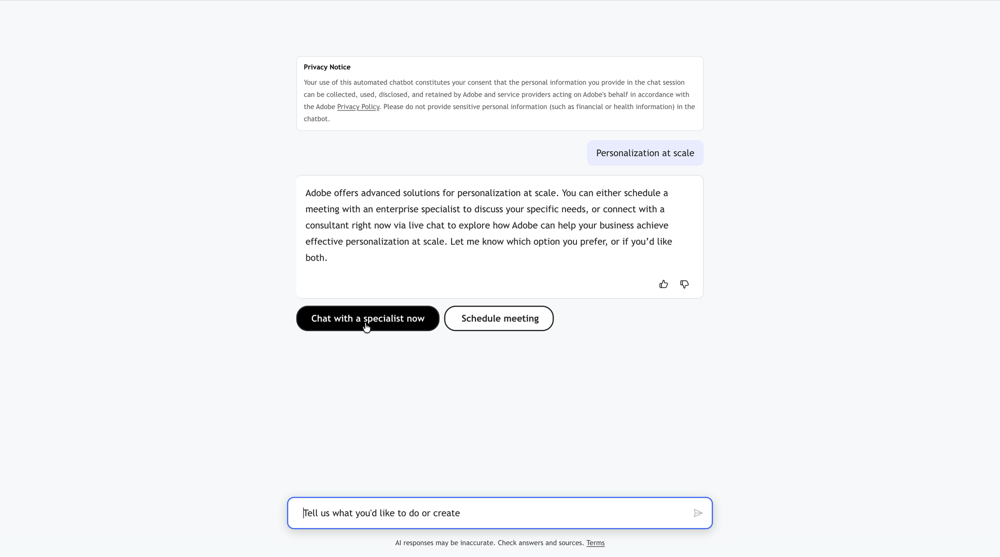
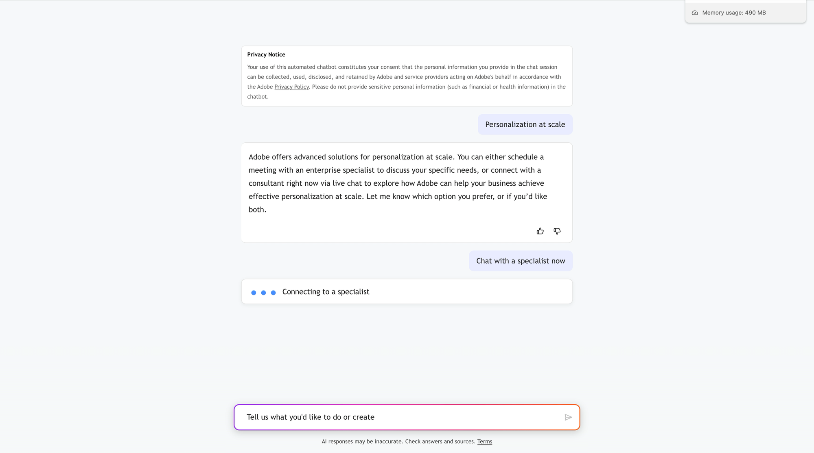

# Chat en direct et aperçu des réservations de réunion {#overview}

Un concierge répond à la plupart des questions tout seul. Certaines conversations ont besoin d’une personne : une négociation de prix, un questionnaire d’approvisionnement, une demande de démonstration. Le chat en direct et la réservation de réunions sont les deux façons dont Brand Concierge donne cette conversation à un humain sans perdre le contexte que le visiteur a déjà fourni.

* Le chat en direct connecte immédiatement le visiteur à un représentant disponible, dans la même fenêtre de chat.
* La réservation de réunion offre au visiteur de véritables créneaux horaires ouverts à partir du calendrier d&#39;un représentant et réserve la réunion.

Les deux sont proposés par la même compétence, **[!UICONTROL remise aux ventes]**, et les deux passent par [!DNL Adobe Marketo Qualifier] (anciennement [!DNL Sales Qualifier]), où vos représentants connectent leurs calendriers, définissent leur disponibilité et prennent part à des discussions.

## Fonctionnement d’une remise {#how-it-works}

Quatre pièces doivent s&#39;aligner avant qu&#39;un visiteur puisse atteindre une personne.

| Pièce | Fonction | Emplacement de configuration |
| --- | --- | --- |
| Profil représentatif | Connecte un calendrier et indique quand le représentant est disponible pour les réunions et les conversations | [!DNL Adobe Marketo Qualifier] > **[!UICONTROL Paramètres de profil]** |
| Routage | Décide *quel* représentant obtient ce visiteur. | [!DNL Adobe Marketo Qualifier] > **[!UICONTROL Règles de routage]** et le type de routage sur chaque intégration |
| Intégrations | **[!UICONTROL Réservation de réunion]** et **[!UICONTROL Chat en direct]** permettent au concierge de vérifier la disponibilité, de lancer une conversation et de réserver une place | Compositeur > **[!UICONTROL Parcourir les intégrations]** |
| Compétence | **[!UICONTROL Remise à l’équipe des ventes]** décide *quand* de proposer une remise, en fonction de l’intention du visiteur | Compositeur > **[!UICONTROL Parcourir les compétences]** |

Au moment de l’exécution, le visiteur dit quelque chose qui correspond à l’une des conditions **[!UICONTROL Utiliser quand]** de la compétence. La compétence se déclenche et appelle les intégrations qui y sont associées. Le routage résout ensuite un représentant et le visiteur se voit proposer une conversation, une réunion ou les deux.

>[!NOTE]
>
>Les compétences et l&#39;intégration sont les éléments de base d&#39;un concierge. Pour le modèle sous-jacent, voir [Structure des compétences et des intégrations](../skills-and-integrations.md).

## L’expérience du visiteur {#visitor-experience}

Lorsque l&#39;habileté se déclenche, le concierge explique les options et les présente comme des boutons dans la conversation.

{width="800" zoomable="yes"}

### Chat en direct {#visitor-live-chat}

Si le visiteur choisit de discuter, le concierge montre un état de connexion lors du routage trouve un représentant disponible.

{width="800" zoomable="yes"}

Avant de rejoindre le représentant, le visiteur remplit un court formulaire de pré-conversation. Ces réponses accompagnent la conversation et apparaissent au représentant sous la forme **[!UICONTROL Détails du formulaire]** dans la boîte de réception du chat, de sorte que le visiteur n’ait pas à répéter quoi que ce soit.

Le visiteur peut mettre fin au chat à tout moment et est invité à confirmer.

{width="800" zoomable="yes"}

### Réservation de réunion {#visitor-meeting-booking}

Si le visiteur choisit de réserver une réunion, le concierge affiche un calendrier avec les créneaux horaires qui sont réellement ouverts sur le calendrier du représentant acheminé, dans le fuseau horaire du visiteur.

{width="800" zoomable="yes"}

Une fois qu’il a confirmé l’emplacement, il reçoit l’e-mail de confirmation du représentant, qui comprend éventuellement un lien [!DNL Microsoft Teams]. Le contexte de la conversation est envoyé au représentant qui a envoyé l’invitation.

## Ce dont vous avez besoin avant de commencer {#prerequisites}

* Accès à [!DNL Adobe Marketo Qualifier], avec vos représentants ajoutés en tant qu’utilisateurs dans le [!DNL Adobe Admin Console].
* Au moins un représentant qui a connecté un calendrier. L&#39;intégration **[!UICONTROL Réservation de réunion]** ne peut pas être activée tant qu&#39;elle n&#39;est pas terminée.
* Au moins un représentant qui a défini la disponibilité du chat en direct. L’intégration **[!UICONTROL Live Chat]** ne peut pas être activée tant que l’un d’eux n’a pas terminé.
* Un concierge dans le compositeur auquel vous pouvez ajouter des intégrations et des compétences.

>[!NOTE]
>
>Le chat en direct et la réservation de réunions ne nécessitent pas de [!DNL Adobe Marketo Engage]. Sans cela, les données relatives aux représentants, aux réunions et aux conversations restent en [!DNL Adobe Marketo Qualifier]. Deux éléments nécessitent une [!DNL Marketo Engage] : les règles de routage personnalisées, qui sont créées à partir des attributs de prospect et d’entreprise [!DNL Marketo], et les types d’activité de concierge qui sont réécrits dans l’enregistrement de personne [!DNL Marketo].

## Configuration du chat en direct et de la réservation de réunions {#setup-path}

Examinez-les dans l’ordre.

1. [Configurer des représentants dans Adobe Marketo Qualifier](representative-setup.md) — connectez un calendrier, définissez l&#39;e-mail de confirmation et définissez le calendrier et la disponibilité du chat en direct.
1. [Acheminer les conversations vers les représentants](routing-rules.md) — choisissez un appel à tour de rôle, un agent direct ou des règles personnalisées basées sur des attributs [!DNL Marketo].
1. [Activer le chat en direct et la réservation de réunion](configure-in-composer.md) — connectez les deux intégrations et activez la compétence **[!UICONTROL Transfert vers les ventes]**.
1. [Boîte de réception de conversation](chat-inbox.md) — Ce que les représentants font une fois une conversation arrivée, y compris noter la conversation.
1. [Données Brand Concierge dans Marketo Engage &#x200B;](marketo-activities.md) — les champs de prospect et les types d&#39;activité réécrits dans [!DNL Marketo], et comment les utiliser dans les campagnes intelligentes.
1. [Surveiller les réunions et les discussions en direct](monitor.md) — la liste des réservations et le tableau de bord des performances.

## Conservation des données {#retention}

Les conversations en direct sont conservées pendant 30 jours.
