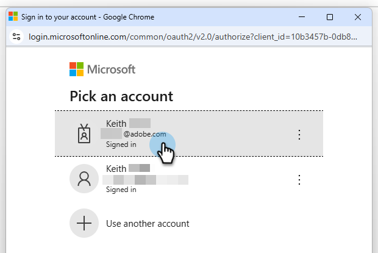
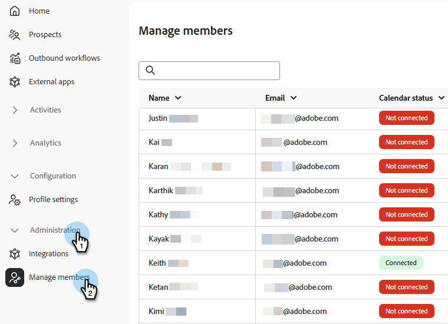

# Configurer des représentants dans Adobe Marketo Qualifier {#representative-setup}

Avant qu&#39;un concierge puisse proposer une réunion ou un chat en direct, au moins un représentant doit être mis en place en [!DNL Adobe Marketo Qualifier]. Chaque représentant le fait une fois, dans son propre profil.

La séquence est la suivante : un administrateur ajoute les utilisateurs, puis chaque représentant connecte un calendrier, écrit son e-mail de confirmation et déclare quand ils sont disponibles pour les réunions et les conversations.

## Ajouter des utilisateurs à l’organisation {#add-users}

Un administrateur ajoute chaque représentant commercial en tant qu’utilisateur dans le [!DNL Adobe Admin Console] et lui accorde l’accès à [!DNL Adobe Marketo Qualifier]. Pour la procédure générale, voir [Ajouter un utilisateur à l’organisation](../user-and-access-management/add-a-user-to-the-org.md) et [Ajouter un utilisateur au rôle](../user-and-access-management/add-a-user-to-the-role.md).

Les représentants effectuent eux-mêmes les étapes restantes.

## Connecter votre calendrier {#connect}

La connexion au calendrier est ce qui rend la disponibilité réelle visible pour un concierge. Sans cela, le représentant n&#39;est pas éligible pour la réservation de réunion.

1. Connectez-vous à [ Adobe Experience Cloud ](https://experience.adobe.com/){target="_blank"} et sélectionnez **[!UICONTROL Adobe Marketo Qualifier]**.

   {width="800" zoomable="yes"}

1. Dans le panneau de gauche, sous **[!UICONTROL Configuration]**, sélectionnez **[!UICONTROL Paramètres de profil]**, puis ouvrez l’onglet **[!UICONTROL Configuration du calendrier]**.

1. Choisissez le calendrier à connecter, [!DNL Microsoft Outlook] ou [!DNL Google Calendar].

   {width="600" zoomable="yes"}

1. Connectez-vous avec un compte existant ou ajoutez-en un nouveau, puis accordez les autorisations demandées.

   {width="600" zoomable="yes"}

1. Examinez l’e-mail de confirmation envoyé à un visiteur lorsqu’il réserve une réunion avec vous.

   Une ligne d’objet et un corps par défaut sont définis pour vous. Modifiez l&#39;un ou l&#39;autre et choisissez d&#39;inclure un lien de réunion [!DNL Microsoft Teams] dans l&#39;invitation.

   {width="600" zoomable="yes"}

1. Sélectionnez **[!UICONTROL Enregistrer]**.

## Définir la disponibilité du calendrier {#calendar-availability}

La connexion à un calendrier [!DNL Adobe Marketo Qualifier] indique quand vous êtes *occupé*. La disponibilité du calendrier indique le moment où vous êtes *prêt* à participer à une réunion. Les deux sont appliqués.

1. Dans **[!UICONTROL Paramètres de profil]**, ouvrez l’onglet **[!UICONTROL Disponibilité du calendrier]**.

   {width="600" zoomable="yes"}

1. Définissez vos règles de réunion.

   | Paramètre | Ce qu’il contrôle |
   | --- | --- |
   | Durée de la réunion | Durée d’exécution d’une réunion réservée et donc longueur de chaque créneau horaire proposé |
   | Durée du tampon | Écart appliqué entre la fin d’une réunion et le début de la suivante |
   | Avis minimal | L’avance qu’un visiteur doit réserver. Par exemple, définissez 4 heures pour empêcher les visiteurs de réserver un emplacement qui commence dans 10 minutes |
   | Fuseau horaire | Fuseau horaire dans lequel sont exprimées vos heures de disponibilité. Les visiteurs voient toujours les créneaux horaires convertis en leur propre fuseau horaire |

1. Définissez les heures disponibles pour chaque jour de la semaine.

   Une journée peut être composée d’un bloc continu, comme de 8 h à 17 h, ou de plusieurs blocs, comme de 8 h à 12 h et de 14 h à 17 h. Laissez un jour vide pour ne pas prendre de réunion ce jour-là.

   >[!NOTE]
   >
   >Pour ajouter un autre bloc de temps à un jour, sélectionnez le signe plus ().

   {width="600" zoomable="yes"}

1. Sélectionnez **[!UICONTROL Enregistrer]**.

### Comment un créneau devient réservable {#slot-logic}

Un créneau horaire n’est proposé à un visiteur que s’il survit aux trois contrôles :

1. Cela correspond aux heures disponibles que vous définissez ici.
1. Il n’est pas déjà occupé par un événement de votre calendrier connecté. Une réunion existante de 9 h supprime le créneau de 9 h.
1. Il satisfait à votre préavis minimum et votre temps de tampon.

## Définir la disponibilité du chat en direct {#chat-availability}

La disponibilité du chat en direct est distincte de la disponibilité du calendrier. Un représentant peut être disponible pour discuter mais ne prendre aucune réunion, ou l&#39;inverse.

1. Dans **[!UICONTROL Paramètres du profil]**, ouvrez l’onglet **[!UICONTROL Disponibilité du chat en direct]**.

1. Définissez votre fuseau horaire, puis définissez les jours et heures où vous êtes prêt à recevoir un chat en direct. Les week-ends peuvent être inclus.

   {width="600" zoomable="yes"}

1. Sélectionnez **[!UICONTROL Enregistrer]**.

>[!NOTE]
>
>Les heures de disponibilité vous rendent *éligible* aux conversations. Votre statut en direct dans la boîte de réception du chat décide si vous les recevez maintenant. Voir [Boîte de réception de conversation](chat-inbox.md).

## Vérifier qui est configuré {#manage-members}

**Administrateurs uniquement.** Sous **[!UICONTROL Administration]**, sélectionnez **[!UICONTROL Gérer les membres]** pour afficher l’état de chaque représentant au même endroit : qui a connecté un calendrier, qui a défini la disponibilité du chat en direct et qui a déconnecté un calendrier.

Utilisez cette option avant d’activer les intégrations dans le compositeur. Un représentant qui apparaît ici sans calendrier connecté n&#39;est pas éligible pour la réservation de réunion, et un représentant sans disponibilité de chat en direct n&#39;est pas éligible au chat en direct.

{width="800" zoomable="yes"}

## Étape suivante {#next}

Lorsqu’au moins un représentant est configuré, décidez de la manière dont les visiteurs seront mis en correspondance avec les représentants. Voir [Acheminer les conversations vers les représentants](routing-rules.md).
