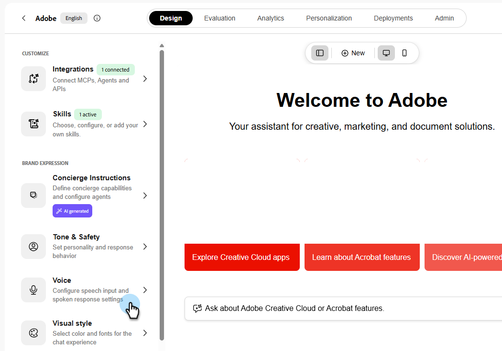

# Activer les conversations vocales

Les conversations vocales dans Adobe Brand Concierge permettent à vos visiteurs de parler avec un concierge au lieu de taper. La voix prend en charge les interactions mains libres et maintient l’expérience multimodale, de sorte que le concierge peut toujours fournir du texte, des images et des liens.

## Comment activer la voix

1. Sur l&#39;écran **Accueil**, sous **Vos concierges**, sélectionnez le concierge où vous souhaitez activer la voix.

   {width="600" zoomable="yes"}

1. Dans l’onglet **Conception**, sélectionnez **Voix**.

   {width="600" zoomable="yes"}

   >[!NOTE]
   >
   >La première fois que vous activez la voix, vous devez consulter l’avis de confidentialité avant de continuer.

1. Dans le panneau _Voix_, activez les options souhaitées, puis sélectionnez **Enregistrer**.
   - **Dictation** : transcrit le texte de ce que disent vos visiteurs et visiteuses.
   - **Mode vocal** : lit à haute voix les réponses du concierge.

   

   >[!NOTE]
   >
   >Les commandes disponibles peuvent varier en fonction de la configuration de votre concierge.

## L’expérience du visiteur

### Les visiteurs peuvent parler naturellement

Après avoir activé la voix, les visiteurs peuvent parler naturellement au concierge. La détection automatique de la parole démarre et arrête l&#39;écoute, de sorte que les visiteurs n&#39;ont pas à sélectionner un bouton à chaque tour.

Les visiteurs peuvent également interrompre le concierge pendant qu&#39;il parle, afin qu&#39;ils n&#39;aient pas à attendre que la réponse soit terminée.

### Réponses textuelles et visuelles

La voix ne limite pas le concierge au son. Au cours d’une conversation vocale, le concierge peut toujours renvoyer du texte, des images et des liens dans le cadre de sa réponse.

## Comment désactiver la voix

1. Sur l&#39;écran **Accueil**, sous **Vos concierges**, sélectionnez le concierge où vous souhaitez désactiver la voix.

1. Dans l’onglet **Conception**, sélectionnez **Voix**.

1. Dans le panneau _Voix_, désactivez les options que vous souhaitez désactiver, puis sélectionnez **Enregistrer**.
